# 主題系統

## Summary

Camelot 的主題系統讓同一組元件介面切換成五種視覺風格：`material`（Material 3）、`cupertino`（Apple）、`scifi`（HUD）、`aqua`（玻璃擬態，預設）與 `tactile`（實心表面加彈簧動態）。目前風格由 `useCamelotTheme()` 管理並存在瀏覽器，可主題化元件依風格渲染對應外觀，props 與 emits 不變。色彩沿用 Material 3 的 `--color-{role}` token，不另立色票；色系細節見色彩主題頁。

## 運作方式

### 主題狀態

| 項目 | 說明 |
| :--- | :--- |
| 可選風格 | `material`、`cupertino`、`scifi`、`aqua`、`tactile` |
| 預設風格 | `aqua`，新使用者首次進入即為玻璃風格 |
| 保存位置 | localStorage 的 `cml-theme-mode` 鍵 |
| 全域標記 | html 元素寫入 `data-camelot-theme-mode` 屬性與 `--cml-active-ui-style` 變數 |
| 樣式核心 | Tailwind CSS v4；共用樣式集中在全域樣式表的 `@utility` 與 `@theme` |

來源：1. [useCamelotTheme.ts](../../../app/composables/useCamelotTheme.ts)　2. [tailwind.css](../../../app/assets/css/tailwind.css)

### Router 元件

Button、Input、Switch、Checkbox、Radio 是 router 元件：本身不畫 UI，依目前風格渲染對應風格的子元件。

其餘可主題化元件，例如 Tabs、Dialog、Steps、Select、Skeleton、Toast、Loading、DatePicker，在元件內依風格分支。

這張圖回答：一個 router 元件怎麼決定要畫哪個風格？

```json diagram id=圖1
{
  "type": "flow",
  "dir": "LR",
  "title": "Router 元件分派",
  "desc": "router 元件讀目前主題風格，渲染對應風格的子元件，並注入角色色 CSS 變數",
  "nodes": [
    {"id": "T", "text": "主題狀態", "shape": "db", "kind": "data"},
    {"id": "R", "text": "Router 元件", "key": true},
    {"id": "M", "text": "Material 版"},
    {"id": "C", "text": "Cupertino 版"},
    {"id": "S", "text": "Sci-Fi 版"},
    {"id": "A", "text": "Aqua 版"},
    {"id": "K", "text": "Tactile 版"},
    {"id": "V", "text": "角色色變數", "kind": "data"}
  ],
  "edges": [
    {"from": "T", "to": "R"},
    {"from": "R", "to": "M", "label": "material"},
    {"from": "R", "to": "C", "label": "cupertino"},
    {"from": "R", "to": "S", "label": "scifi"},
    {"from": "R", "to": "A", "label": "aqua"},
    {"from": "R", "to": "K", "label": "tactile"},
    {"from": "R", "to": "V", "label": "注入 CSS 變數", "kind": "async"}
  ]
}
```



來源：1. [Button.vue](../../../app/components/Camelot/Button.vue)　2. [useCamelotRoleColorClass.ts](../../../app/composables/useCamelotRoleColorClass.ts)

### 主題切換漸變

切換主題風格、深淺色、色系或品牌色時，全站顏色以漸變過場：

1. 在 html 元素暫時加上漸變 class，360ms 後移除。
2. 期間所有元素的底色、文字、邊框、fill、stroke 以 0.32 秒的 ease-ios 過場。
3. 計時器是全域單例，連續觸發只會重置同一個計時器。
4. 使用者偏好減少動態時不加 class，也就沒有過場。

主題風格與深淺色的監聽在首次載入時不觸發，避免開頁閃動。

品牌色與色系由設定主題色的函式觸發；需要手動觸發時可呼叫 `triggerThemeTransition`。

來源：1. [useCamelotTheme.ts](../../../app/composables/useCamelotTheme.ts)　2. [tailwind.css](../../../app/assets/css/tailwind.css)

## 表單控制項高度與字級

Input、Select、NumberCounter、DatePicker 系列與 Button 在五個主題都以 42px 為最低高度，並排時對齊。

字級 1rem 設在元件根節點，外部 CSS 可以覆蓋；字級變大時，高度跟著撐高。

| 主題 | 欄位樣式 |
| :--- | :--- |
| material | Filled 欄位；Input 另有 `labelMode`，預設 outside，floating 時最低高度 56px |
| cupertino | Cupertino Input 樣式，沒有可見框線 |
| scifi | 欄位包在 HUD 外框裡 |
| aqua | 半透明軌道底與 12px 圓角 |
| tactile | 實心灰階底與 14px 圓角，聚焦時轉亮底並加 2px 角色色外框 |

來源：1. [Input.vue](../../../app/components/Camelot/Input.vue)　2. [NumberCounter.vue](../../../app/components/Camelot/NumberCounter.vue)　3. [FieldFrame.vue](../../../app/components/Camelot/Internal/FieldFrame.vue)　4. [useCamelotPickerTheme.ts](../../../app/composables/useCamelotPickerTheme.ts)

## Aqua 視覺語言

玻璃擬態：半透明、背景模糊、髮絲邊、柔光與 spring 動畫，由全域樣式表的共用 utility 提供。

| utility | 用途 |
| :--- | :--- |
| `aqua-glass` | 浮層與面板：半透明、模糊、讀邊框 token 的髮絲邊與柔影，用於 Dialog、Select 浮層、DatePicker 面板 |
| `aqua-fill` | 填滿態：135° 漸層、頂部內高光與收緊柔光，用於按鈕、選中 pill、checkbox 勾選、switch 開 |
| `aqua-track` | 軌道與未選態：髮絲級半透明底加細邊 |
| `aqua-glow` | 聚焦光暈，可搭配 focus 或 focus-within 變體 |
| `aqua-thumb` | 玻璃光澤拖點，用於 switch thumb |

來源：1. [tailwind.css](../../../app/assets/css/tailwind.css)

### 圓角 token

Aqua 表單控制項不用膠囊圓角，統一消費兩個圓角 token：

| token | 值 | utility | 消費者 |
| :--- | :---: | :--- | :--- |
| `--radius-aqua-control` | 12px | `rounded-aqua-control` | Button、Input、Select 觸發器、NumberCounter、Textarea、日期與時間選擇器觸發欄位 |
| `--radius-aqua-panel` | 16px | `rounded-aqua-panel` | Select 選單面板、日期與時間選擇器浮層面板與其落影容器 |

面板與它的落影容器圓角必須一致，否則落影會露出方角。

Tabs、Switch、Radio、Checkbox、Slider thumb、Pagination 頁碼維持膠囊或圓形；Dialog 面板是大面積浮層，維持 `rounded-3xl`。

來源：1. [tailwind.css](../../../app/assets/css/tailwind.css)

## Tactile 視覺語言

實心表面、灰階軌道與墨色選中態，可按的東西按下會縮小再以彈簧回彈。色彩全部取自 Material 3 的表面色階與角色色，不另立色票，深淺色與色系切換自動生效。

| utility | 用途 |
| :--- | :--- |
| `tactile-surface` | 實心表面：最淺表面色、頂緣內高光與柔和落影，用於 Dialog、選項面板、Table、Drawer |
| `tactile-well` | 軌道與未選態：灰階底混入 10%% 角色色，用於輸入底、分頁底、滑桿軌道，換主題色時跟著染色 |
| `tactile-fill` | 填滿態：角色色平塗加同色柔影，用於按鈕、開關開啟、勾選 |
| `tactile-ink` | 墨色反相表面：只用於 Tooltip 這類浮層，維持中性 |
| `tactile-thumb` | 實心白拇指，用於 switch 與 slider |
| `tactile-ring` | 鍵盤焦點環，搭配 focus-visible 變體 |

| token | 值 | 消費者 |
| :--- | :---: | :--- |
| `--radius-tactile-control` | 14px | Button、Input、Select 觸發器、NumberCounter、Textarea、日期與時間觸發欄位 |
| `--radius-tactile-panel` | 22px | 選項面板、日期與時間浮層、Table、Accordion |
| `--ease-tactile` | 彈簧曲線 | 所有 tactile 動態；瀏覽器不支援時退回一條過衝的貝茲曲線 |

| 互動規則 | 說明 |
| :--- | :--- |
| 按壓回饋 | 按鈕、勾選框、單選鈕按下時縮小，放開以彈簧回彈 |
| 拇指拉伸 | 開關按住時拇指橫向拉長，開啟狀態下往軌道內側長 |
| 分頁與步驟 | 分頁滑塊以 0.6 秒的彈簧滑動；步驟的進行中節點放大、完成節點彈出 |
| 滑桿 | 軌道 10px，拇指是亮底外環包著角色色圓點，按住放大；刻度只顯示等寬小字 |
| 勾選描線 | 勾號以描線方式出現 |
| 選中態 | 分頁滑塊、編輯器啟用鈕、頁碼、日期選中日與自己的訊息泡泡用角色色平塗，換主題色時一起變 |
| 選單選中文字 | 選單與下拉的選中項用一般文字色加粗，不用角色色，避免淺色角色色疊在灰底上看不清 |
| 減少動態 | 使用者偏好減少動態時，上述過場全部關閉 |

來源：1. [tailwind.css](../../../app/assets/css/tailwind.css)　2. [Tactile/Switch.vue](../../../app/components/Camelot/Tactile/Switch.vue)　3. [Tactile/Checkbox.vue](../../../app/components/Camelot/Tactile/Checkbox.vue)

## 共用 token 與色彩規則

### 邊框 token

語意化邊框色 `--color-border` 同時產生 border-border 工具，預設等於 M3 的 outline-variant。

aqua 主題在根節點把它覆寫成角色色 12% 的淡色髮絲線。玻璃面板與軌道兩個工具的邊框都讀這個 token，所以 Dialog、Sheet、Toast、Table、選項面板與 DatePicker 的邊框會一起變化。

玻璃面板頂部的內高光是 18% 白，底色是 72% 的 surface；個別元件可再覆寫底色，例如通知卡用 55%。

來源：1. [tailwind.css](../../../app/assets/css/tailwind.css)

### 色彩角色與前景配對

元件的 `color` prop 經 [useCamelotRoleColorClass](../features/composables/useCamelotRoleColorClass.md) 解析成兩個 CSS 變數：角色色與它的配對前景色。傳入 container 旗標時改用 container 色階。

| 規則 | 說明 |
| :--- | :--- |
| 前景配對 | 底色用角色色的表面，文字與圖示一律用配對前景色，不寫死 on-primary 或白色 |
| Teleport 浮層 | 浮層離開原本的 DOM 位置後 CSS 變數不再繼承，要在浮層上重新套角色 class，或以 inline style 帶入目前的角色色 |
| 狀態色預設值 | info、warning、success 在色系未設定時有內建的藍、橘、綠，前景為白，不會變成黑色 |

來源：1. [useCamelotRoleColorClass.ts](../../../app/composables/useCamelotRoleColorClass.ts)　2. [tailwind.css](../../../app/assets/css/tailwind.css)

### 樣式寫法

| 規則 | 說明 |
| :--- | :--- |
| 優先 utility | 動態 style 與 scoped CSS 盡量改用 Tailwind utility、before 與 after 變體、arbitrary value |
| 共用動畫 | 共用 keyframes 如 `scifi-scan`，與緩動 `ease-spring`、`ease-ios` 集中在 `@theme` |
| 保留 scoped CSS | 含 keyframes、原生捲軸樣式、transition-group 或 deep 選擇器的元件，例如 Scrollbar、RippleEffect、Reveal 系列、Sci-Fi 外框 |

來源：1. [tailwind.css](../../../app/assets/css/tailwind.css)

## 相關 Composables 與型別

| 名稱 | 說明 |
| :--- | :--- |
| [useCamelotTheme](../features/composables/useCamelotTheme.md) | 主題風格、深淺色、色彩方案與主題色設定 |
| [useCamelotRoleColorClass](../features/composables/useCamelotRoleColorClass.md) | 把 `color` 角色解析成設定 `--cml-color-current-*` 的 class |
| [useCamelotPickerTheme](../features/composables/useCamelotPickerTheme.md) | DatePicker 各風格的觸發欄位、面板與選中底色 class |
| `CamelotColorRole` | 共用色彩角色 union：primary、secondary、tertiary、error、info、warning、success |
| `CamelotInputType` | Input 原生 type union：text、password、email、number、tel、url、search |

來源：1. [camelot.ts](../../../shared/types/camelot.ts)

## 相關頁面

- [色彩主題](./color-scheme.md)
- [元件清單](../features/components.md)

---
[⚙️ Env](../environment.md) | [🏠 Wiki](../index.md)
